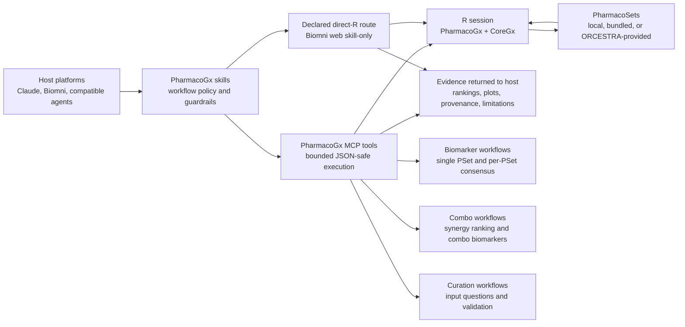

# PharmacoGx Plugin Architecture And Manuscript Figures

PharmacoGx is a portable skill-and-tool plugin for external agent platforms. It
does not define a standalone agent or prescribe a foundation model.

## Architecture Schematic

## Candidate Figures

1. Plugin schematic showing external hosts, shared Skills, typed MCP and
   Skill-only direct-R execution, and local or ORCESTRA-provided PharmacoSets.
2. Gemcitabine biomarker case study seeded by SLC29A1/hENT1, with PSet-backed
   evidence and external context kept separate.
3. Multi-PSet biomarker consensus workflow showing independent per-PSet tests
   and direction/p-value synthesis without raw pooling.
4. High-confidence combo synergy ranking using real combo PSets such as
   NCI-ALMANAC or GDSC-square Matrix/Anchor.
5. Combo biomarker workflow using a selected synergy or combo-response
   phenotype and mutation/CNV features.
6. Agent benchmark summary: task success, correct tool selection,
   reproducibility, unsupported-data handling, and hallucination avoidance.

## Benchmark Scenarios

- Identify a known drug biomarker candidate and verify whether PSet evidence is
  available.
- Compare biomarker support across multiple PSets without pooling raw data.
- Rank synergistic drug combinations from a real combo PSet.
- Explain why a combo biomarker result is exploratory when sample or feature
  support is sparse.
- Distinguish toy-data demonstrations from real local PSet-backed analyses.

## Deployment Stages

1. Skill-only Biomni web demonstration using the current PharmacoGx PSet
   catalog, approved downloads, and direct R.
2. ORCESTRA metadata discovery once the query API is available.
3. Hosted authenticated MCP endpoint registered as a Biomni web custom
   connector.
4. Matched baseline, Skill, MCP, and Skill+MCP evaluation before manuscript
   claims are finalized.
